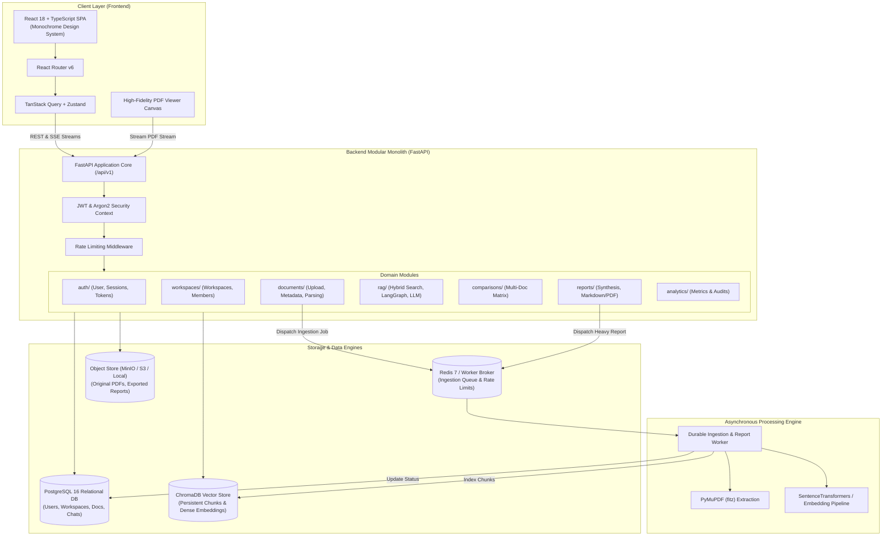
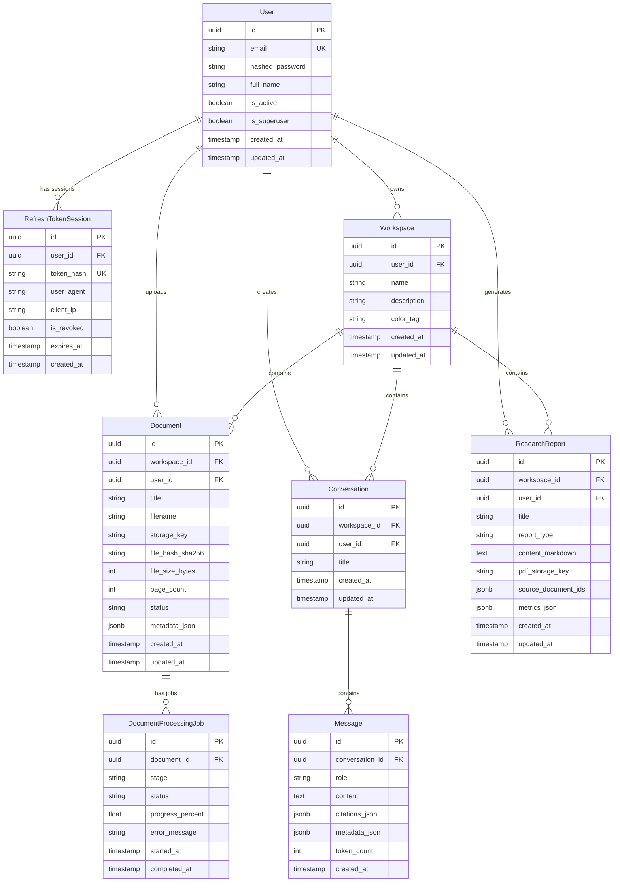
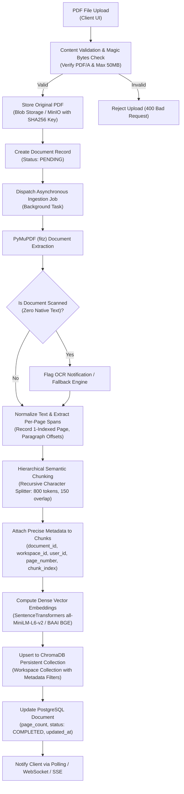
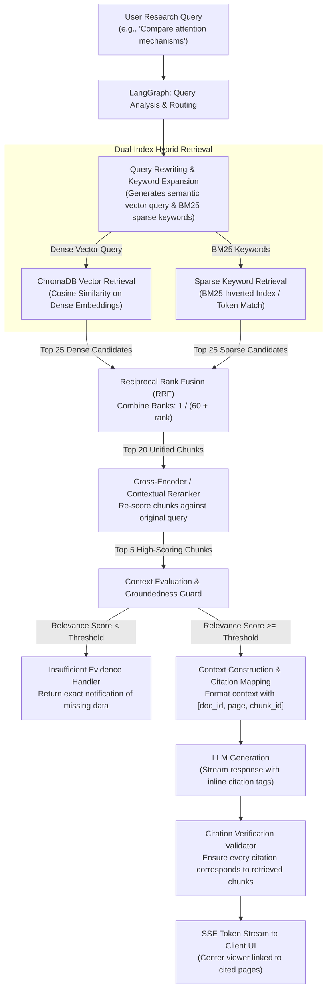
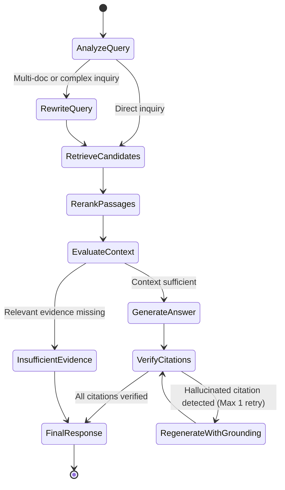

# IntelliResearch — System Architecture & Technical Design Document

**Document Version:** 1.0.0  
**Status:** Approved Architectural Blueprint  
**System Type:** Modular Monolith with Asynchronous Background Ingestion & Hybrid RAG

---

## 1. System Overview & Architecture Paradigm

IntelliResearch is designed as a high-performance **Modular Monolith**. This paradigm provides:
1. Low operational overhead and single-process cohesion for developer ergonomics and deployment simplicity.
2. Clear internal domain boundaries (Authentication, Workspaces, Documents & Storage, Vector Engine, RAG & LLM Orchestration, Reports & Analytics).
3. Asynchronous decoupled background workers for CPU-intensive PDF parsing, tokenization, sentence-embedding computation, and report compilation.
4. Clean adapter interfaces for databases (SQLAlchemy 2.0 async supporting PostgreSQL in production and SQLite in testing), object storage (S3/MinIO and local filesystem storage), and vector stores (ChromaDB persistent collections).



---

## 2. Database Relationship Diagram (ERD)

The relational schema is normalized, indexed for multi-tenant query performance, and maintains relational integrity via foreign key cascades.



---

## 3. Document Ingestion Pipeline Architecture



---

## 4. Advanced Hybrid RAG Engine Workflow



---

## 5. LangGraph Orchestration State Machine



---

## 6. Security Architecture & Multi-Tenant Isolation

1. **Authentication:**
   - Password hashes stored using **Argon2id** (memory cost 65536 KB, time cost 3 iterations, parallelism 4).
   - JWT Access tokens: HS256 / RS256 with 15-minute expiration containing `sub: user_id`, `exp`, `jti`.
   - Refresh tokens: Stored cryptographically hashed in `RefreshTokenSession` table with 14-day expiration. Automatic rotation: using a refresh token issues a new pair and revokes the old token.

2. **Tenant Isolation:**
   - Database layer: Every query joins or filters by `user_id = current_user.id`. No user can access or manipulate workspaces, documents, or reports belonging to another user.
   - Vector database layer: ChromaDB queries strictly inject `where={"workspace_id": workspace_id, "user_id": user_id}`.

3. **Untrusted Document Defense:**
   - PDF uploads are subjected to binary magic-number validation (`%PDF-1.x`).
   - Text extracted from PDFs is treated as untrusted data and strictly isolated from system prompts via delimited context boundaries:
     ```
     <SOURCE_EVIDENCE doc_id="..." page="...">
     ... extracted document content ...
     </SOURCE_EVIDENCE>
     ```
   - System prompts forbid executing instructions found within document evidence.

4. **API Security:**
   - CORS restricted to configured frontend origins.
   - Per-IP and per-user rate limiting on compute-heavy LLM and ingestion endpoints.

---

## 7. Technical Decision Records (TDR)

| Decision | Selected Choice | Rationale | Alternatives Considered |
|---|---|---|---|
| **Architecture** | Modular Monolith (FastAPI) | High development speed, unified typing, single deployment target, zero microservice network latency. | Microservices (rejected: unnecessary complexity for current scale). |
| **Relational DB** | PostgreSQL 16 + SQLAlchemy 2.0 (Async) | Industry standard, robust ACID transactions, JSONB support for metadata, Alembic migrations. Works with SQLite for lightweight local unit tests. | MySQL, MongoDB. |
| **Vector DB** | ChromaDB (Persistent Client) | Python-native, zero-external-dependency local mode, metadata filtering, native cosine similarity. | Pinecone (cloud-locked), Milvus (heavyweight). |
| **PDF Extraction** | PyMuPDF (fitz) | 10x-50x faster than pypdf/pdfminer, highly accurate bounding boxes, robust handling of complex academic layouts. | pdfplumber, pypdf. |
| **Retrieval Strategy** | Hybrid (Dense Vector + BM25) + RRF | Pure dense search misses exact scientific abbreviations and dataset names; pure BM25 misses semantic paraphrasing. RRF unites both. | Dense only, Sparse only. |
| **Frontend Stack** | Vite + React + TypeScript + Tailwind | Extreme speed, strict type safety, predictable state, custom monochrome design token system. | Next.js (unnecessary SSR overhead for desktop research app). |
| **Design Language** | Monochromatic (`#080808` to `#FFFFFF`) | High contrast, minimal visual fatigue during long research sessions, elegant and distraction-free. | Generic colorful SaaS templates. |

---

## 8. Sign-Off & Verification
- All architectural subsystems, entity diagrams, pipelines, and security controls are defined and documented.
- Ready for Phase 03: Project Initialization.

